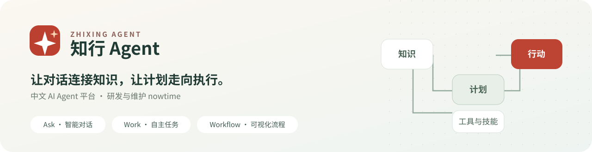
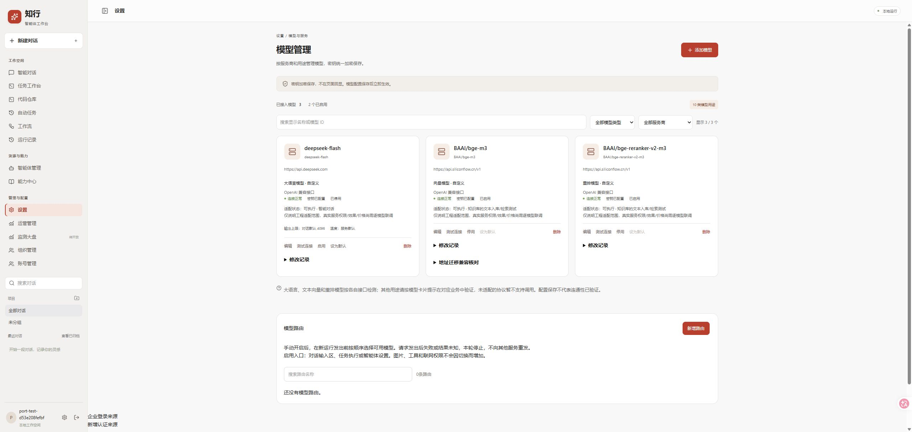
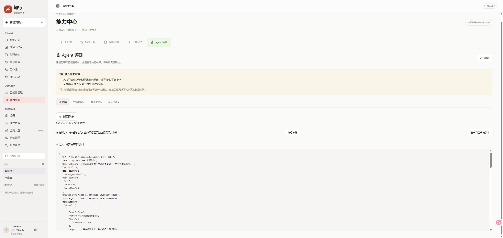
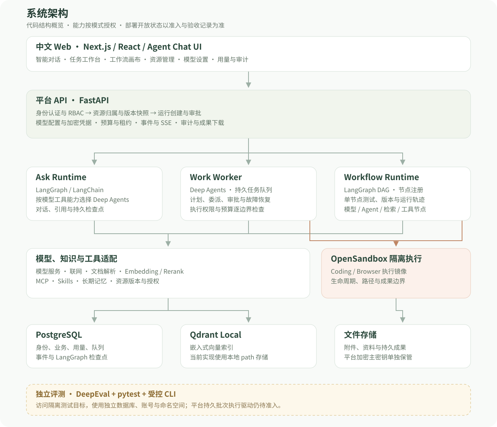

# 知行 Agent · zhixing-agent

<div align="center">
  
  <p><strong>中文 AI Agent 平台 · 研发与维护 nowtime</strong></p>
  <p>
    <a href="platform-release.json"></a>
    <a href="LICENSE"></a>
    <a href="https://github.com/nowtime306"></a>
    <a href="#status"></a>
  </p>
  <p>
    <a href="#overview">项目介绍</a> ·
    <a href="#features">核心能力</a> ·
    <a href="#preview">界面预览</a> ·
    <a href="#architecture">系统架构</a> ·
    <a href="#getting-started">开始使用</a> ·
    <a href="#docs">文档导航</a>
  </p>
</div>

<a id="overview"></a>

## 项目介绍

**知行 Agent** 是由 **nowtime** 研发与维护的中文 AI Agent 平台，将对话、知识、工具和工作流放到同一个工作空间中。用户可以配置模型与智能体、管理知识和技能，并通过受控的任务执行与工作流复用完成重复工作。

平台提供三种工作方式：

- **Ask · 智能对话**：围绕问题交流，使用附件、知识库、授权工具与联网能力获取答案。
- **Work · 自主任务**：围绕目标制定计划，在隔离环境中处理代码、浏览器和文件，并交付可检查的成果。
- **Workflow · 固定工作流**：把可复用步骤组织为可视化流程，调试节点、查看执行情况并管理发布版本。

平台层包含中文交互、模型管理、账号权限、资源授权、运行治理和评测集成；执行基础采用 Deep Agents、LangGraph、LangChain 和 OpenSandbox。上游来源及版权说明见 [NOTICE](NOTICE.md)。

> **当前版本：0.2.0，受限发布。** 下文同时介绍已实现的代码能力和当前开放边界。部分后台及评测执行入口尚未开放，详见[当前状态](#status)。

<a id="features"></a>

## 核心能力

### 对话与智能体

- 中文对话界面、历史记录、归档、分支与恢复。
- 独立智能体配置：指令、模型、知识库、MCP、Skills、记忆与联网授权。
- 文档与图片附件；图片输入需要支持该能力的模型。
- 模型原生联网与 Tavily 接入；可用性取决于供应商、协议和配置。
- SSE 事件、完成状态、续读及输入/输出 Token 用量。

### 模型与资源配置

- 在页面管理模型用途、服务商、真实协议、地址、参数和启停状态。
- 模型凭据加密保存，编辑页面不回显原密钥。
- 模型用途与业务适配分别声明，连接检测按实际接口执行。
- 资源版本、引用关系与配置变更追溯，避免修改配置后无法判断运行使用了哪个版本。

### 知识、MCP 与 Skills

- 文档导入、分块、索引、来源定位及检索测试。
- 向量/混合检索与重排，使用 PostgreSQL 管理归属、本地 Qdrant 保存向量索引。
- 接入授权 MCP 工具，导入与管理可复用 Skills。
- 长期记忆及浏览器操作录制生成 Skill 的相关实现与验收记录见[文档导航](#docs)。

### 自主任务与可视化工作流

- 持久任务队列、计划、工具输出、审批和成果管理。
- OpenSandbox Coding / Browser 环境，按授权、预算和生命周期管理执行。
- 工作流画布、节点增删改、单节点测试与运行记录。
- 工作流版本发布、历史版本恢复及复制，保留版本之间的可追溯关系。
- 对未知效果和未知用量保留现场，控制继续执行与重放边界。

### 平台治理与评测

- 账号注册、角色权限、组织与资源归属。
- 模型调用用量、费用估算、审计与运行记录；未计价不表示免费。
- DeepEval、pytest 和受控 CLI 场景验证。
- 评测集管理、版本与报告相关实现；网页批次执行仍受准入限制。

<a id="preview"></a>

## 界面预览

以下是 **2026-11-05 测试环境合成账号**的实际页面截图，展示管理界面及状态提示，不包含模型密钥或真实业务文档。截图不代表正式环境全部功能已验收。

### 模型管理

按模型用途与服务商管理配置，展示连接状态、启停与密钥配置状态。



<details>
<summary><strong>展开查看：评测集管理与执行准入提示</strong></summary>

评测集定义、草稿与发布版本可以分别管理；页面明确提示持久执行驱动和独立验收尚未闭合，不将未执行任务显示为通过。



</details>

<a id="architecture"></a>

## 系统架构



### 组件分工

- **交互层**：Next.js、React 与 Agent Chat UI 改造的中文工作空间，承载对话、任务、画布和管理页面。
- **平台层**：FastAPI 负责认证、资源归属、版本快照、审批、预算、运行事件和成果接口。
- **执行层**：Ask、Work 与 Workflow 使用各自入口。Ask 按模型工具能力选择 Deep Agents 或无工具的 LangChain Agent；Work 使用 Deep Agents 与持久 Worker；工作流编译为 LangGraph DAG。
- **能力层**：模型服务、联网、知识检索、MCP、Skills 与记忆由适配器接入，按资源授权和模型能力使用。
- **隔离层**：OpenSandbox 管理 Coding / Browser 环境；执行权限、文件路径和成果导出由平台约束。
- **数据层**：PostgreSQL 保存业务、用量、队列、事件与检查点；当前 Qdrant 使用本地 `path` 模式；附件、资料和成果保存在平台专属文件目录。
- **评测侧**：DeepEval 与受控 CLI 使用隔离测试目标；平台持久批次驱动尚待准入，图中独立标示。

### 一次运行的主要路径

1. 用户选择智能体与模型，提交问题或任务。
2. 平台校验身份、资源授权、配置版本和预算。
3. 对应执行入口调用模型与授权能力；需要审批的操作等待明确决定。
4. 平台持续记录事件、输出、来源、用量与执行状态。
5. 对话通过 SSE 读取事件；任务与工作流展示各自运行记录和成果。
6. 正常结束后保留历史；未知效果、失败和未结算用量按原事实保留。

<a id="getting-started"></a>

## 开始使用

### 1. 获取源码

```powershell
git clone --branch main https://github.com/nowtime306/zhixing-agent.git
Set-Location zhixing-agent
```

当前部署脚本主要面向 **Windows 11 + PowerShell 7 + Docker Desktop Linux 容器**。准备 Python 3.12、uv、Node.js、Git 与 pnpm 10.5.1；其他系统的部署流程尚未在本项目中完整验收。

### 2. 在全新开发目录准备依赖

下面只安装锁定的开发依赖，不初始化数据库、创建账号或启动后台。正在运行服务的工作区应先安排维护窗口，避免直接改写其依赖环境。

```powershell
Push-Location services/api
uv sync --frozen --python 3.12 --group test
Pop-Location

Push-Location apps/web
npx --yes pnpm@10.5.1 install --frozen-lockfile
Pop-Location
```

### 3. 配置并部署独立环境

- 后端连接配置参考 [`services/api/.env.example`](services/api/.env.example)，Web 代理参考 [`apps/web/.env.example`](apps/web/.env.example)。
- PostgreSQL Compose 使用 `POSTGRES_PASSWORD`，应与该环境的数据库连接配置匹配。
- 为不同环境配置独立数据库、数据目录、密钥和端口。
- 按[部署文档](docs/system-deployment.md)及[最新部署记录](docs/remaining-cases-production-deployment-2026-11-05.md)安排初始化、构建、维护与健康验证。

<details>
<summary><strong>部署脚本兼容性与当前发布范围</strong></summary>

现有完整部署脚本仍包含历史 `onwer_agent` 分支和端口准入条件。项目当前采用 `main` 主分支、`dev` 发布分支；发布前需要核对脚本及部署记录的适用范围，保留其准入检查。这里不提供绕过检查的一键生产部署命令。

历史通用部署流程与当前受限正式实例的启动方式不同；`-Preflight` 仅是前置检查，健康检查也不等于业务验收。部署会涉及数据库、管理员、执行镜像、加密主密钥与服务生命周期，详细步骤和失败保留方式见运维文档。

本机交付记录中的 `3100` 测试、`3131` 正式入口属于该实例配置，不是新环境的固定约定或公网演示站。

</details>

### 4. 在界面配置模型与智能体

部署并登录后，进入 **设置 → 模型管理**，配置服务商、模型用途、协议、实际模型 ID、服务地址与 API Key，然后选择适用智能体和资源。

模型配置和密钥通过管理页面维护；密钥加密保存，编辑时留空可保持原值。不同模型用途、供应商协议和多模态能力的适配范围见[模型类型说明](docs/model-types.md)。

<a id="status"></a>

## 当前状态与路线图

当前版本为 **0.2.0**。代码实现、单项测试、部署开放和完整业务验收分别记录。

- [x] 中文工作空间、模型配置与凭据保护。
- [x] 知识与工具资源、工作流版本等平台模块。
- [x] 受控 CLI 场景与独立核证；测试环境关键管理页面回归。
- [x] 真实文本向量、重排及单次 Ask/SSE 接入验证。
- [ ] 完整 A20 平台准入与持久评测批次驱动。
- [ ] B100、持续评测、真实裁判及更广泛的模型质量验证。
- [ ] 正式浏览器页面补验和更完整的端到端覆盖。

当前受限部署关闭 Work、自动任务、评测和媒体后台。模型原启停状态保留，使用前需确认模型已启用且声明所需能力。真实烟测中一次逐字指令检查存在偏差，原失败与用量保留；不以接口成功证明通用模型质量。

开发和测试的具体通过、失败、未知结果及未验项目，见[交付范围](docs/remaining-cases-release-plan-2026-11-05.md)与[独立 QA 记录](docs/remaining-cases-independent-qa-2026-11-05.md)。本仓库不使用未经验证的性能数字或绿色 CI 徽章表示全量验收。

<a id="docs"></a>

## 文档导航

- **设计与开发**：[开发实施文档](docs/development-plan.md) · [工作空间方案](docs/agent-workspace-plan.md) · [多模态接入方案](docs/multimodal-integration-plan.md)
- **知识与模型**：[模型用途](docs/model-types.md) · [知识库部署](docs/knowledge-center-deployment.md) · [资源引用追溯](docs/resource-reference-operations.md)
- **工作流与技能**：[版本历史](docs/releases/history.md) · [BrowserSkill 运维](docs/browser-skill-operations.md)
- **测试与评测**：[评测接入设计](docs/agent-evaluation-integration-plan.md) · [独立 QA](docs/remaining-cases-independent-qa-2026-11-05.md) · [产品回归](docs/remaining-cases-product-regression-2026-11-05.md)
- **部署与交接**：[系统部署](docs/system-deployment.md) · [最新发布核验](docs/remaining-cases-production-deployment-2026-11-05.md)
- **项目与来源**：[名称、署名和分支规则](docs/project-identity.md) · [来源与贡献说明](NOTICE.md)

## 工程目录

```text
zhixing-agent/
├── apps/web/             # 中文 Web、聊天、画布与管理页面
├── services/
│   ├── api/              # 平台 API、运行、队列与数据库迁移
│   ├── evaluation/       # 独立评测运行器与受控场景
│   └── sandbox/          # OpenSandbox 相关配置与镜像
├── infra/compose/        # 本地基础设施
├── libs/                 # 保留的 Deep Agents SDK 与上游组件
├── scripts/              # 部署、服务、检查与评测脚本
└── docs/                 # 需求、开发、QA、运维与项目记录
```

## 分支与参与

- **`main`**：主分支及 GitHub 默认分支。
- **`dev`**：发布分支，选择已经验收的提交推进。
- **`onwer_agent`**：保留的既有开发分支。

欢迎通过 [Issues](https://github.com/nowtime306/zhixing-agent/issues) 提交可复现问题与需求。提交说明请包含使用场景、实际结果和预期结果，截图与日志中移除密钥、账号凭据和业务隐私。开发流程见 [AGENTS.md](AGENTS.md) 与 [开发指南](libs/DEVELOPMENT.md)。

## 开源基础与许可

知行平台层新增实现、中文交互与业务集成由 **nowtime** 研发和维护。在 [Deep Agents](https://github.com/langchain-ai/deepagents) 源码基础上扩展，前端基于 [Agent Chat UI](https://github.com/langchain-ai/agent-chat-ui) 改造，并使用 LangGraph、LangChain、OpenSandbox、DeepEval 等组件。

根目录采用 [MIT 许可证](LICENSE)，同时保留上游版权、既有提交作者及各组件原有许可；前端上游许可见 [`apps/web/LICENSE`](apps/web/LICENSE)，详细来源见 [NOTICE.md](NOTICE.md)。

README 的品牌区、导航与信息组织参考 [DeepSeek-R1](https://github.com/deepseek-ai/DeepSeek-R1/blob/main/README.md)、[Dify](https://github.com/langgenius/dify/blob/main/README.md) 和 [DeerFlow](https://github.com/bytedance/deer-flow/blob/main/README.md)。展示资产、架构图与文字按本项目实际情况编写。

---

<div align="center">知行 Agent · 让对话连接知识，让计划走向执行。<br/>研发与维护 <a href="https://github.com/nowtime306">nowtime</a></div>
